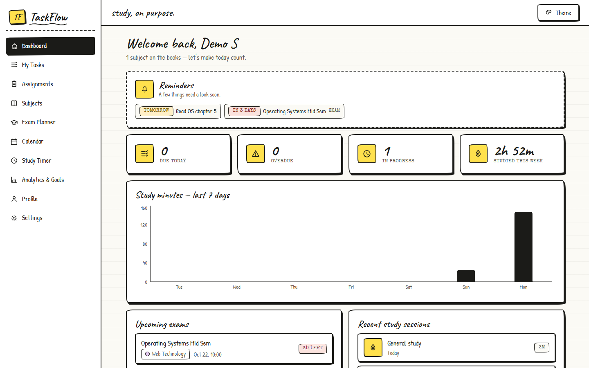
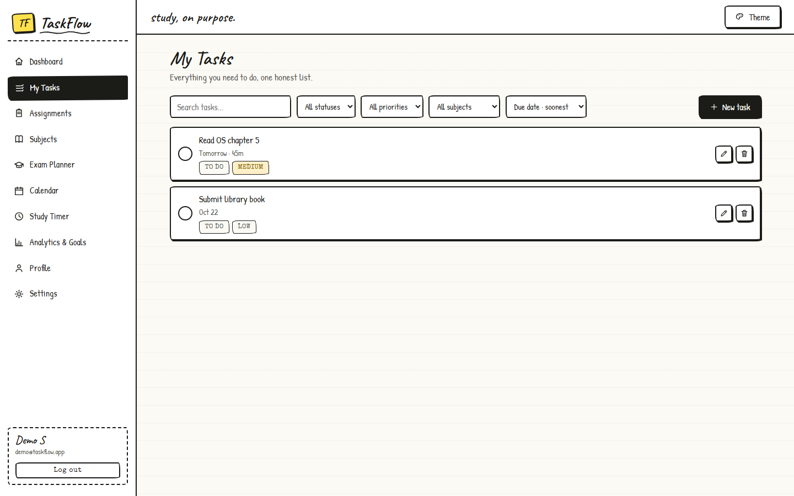
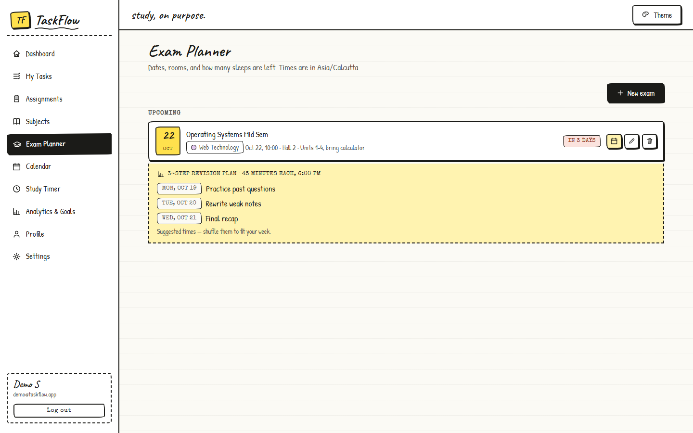
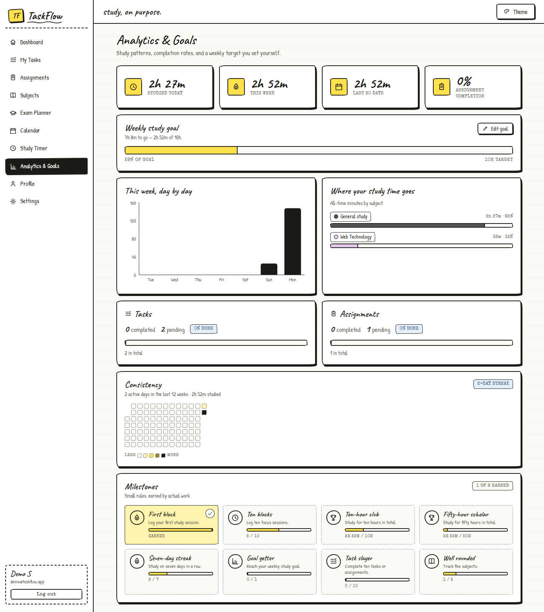
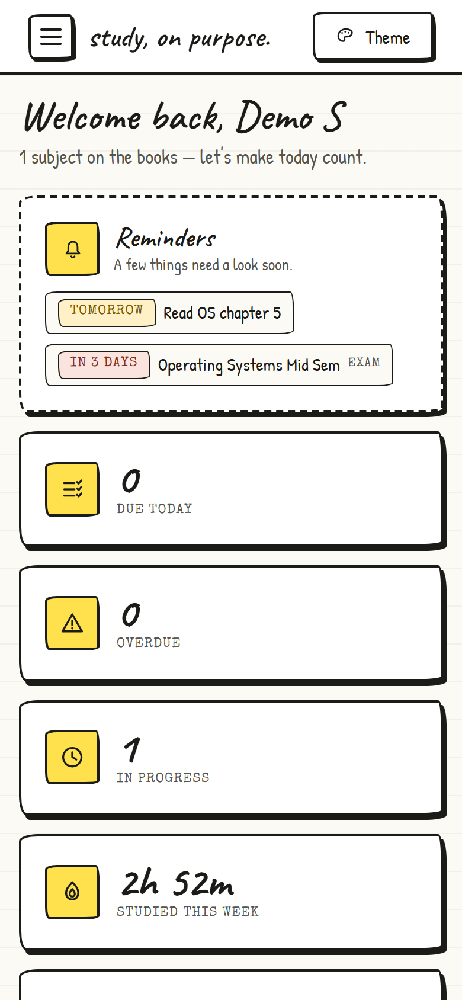
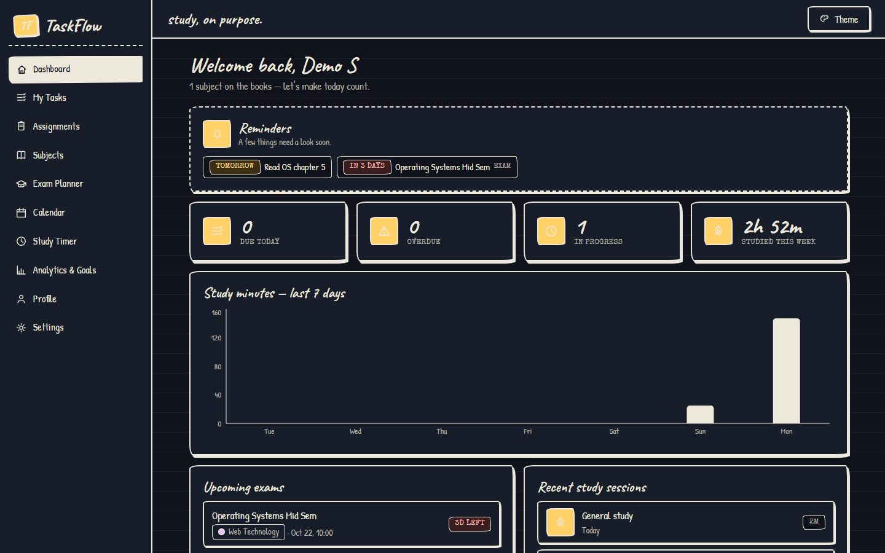

# TaskFlow

A student productivity and study-management app built with the MERN stack. TaskFlow keeps
tasks, assignments, subjects, exams, study sessions, and progress analytics in one place,
wrapped in a hand-drawn "study, on purpose" interface with four switchable themes.

Built as an MCA portfolio project.

## Screenshots



| Tasks | Exam planner with revision plan |
| --- | --- |
|  |  |



| Mobile dashboard | Midnight theme |
| --- | --- |
|  |  |

## Features

- **Accounts** — register, log in, log out, profile and study preferences.
- **Dashboard** — today's workload, upcoming exams, weekly study chart, reminders.
- **Tasks & assignments** — CRUD, filters, search, sorting, priorities, deadlines,
  completion tracking, daily/weekly/monthly recurring tasks, and a `cancelled` status
  that is excluded from all completion metrics.
- **Collaboration** — study groups with invitations and owner/admin/member roles;
  per-assignee task assignments with a reviewable lifecycle (pending → accepted →
  in progress → submitted → completed / needs revision, plus decline and cancel);
  task comments; a server-side append-only activity history; and a per-user
  notification inbox. Task privacy is strict: only the creator and explicitly
  assigned users can see a task — group membership never grants access.
- **Subjects** — color-coded subjects with archive support and safe deletion rules.
- **Exams** — countdown badges, create/edit/delete (including an optional 0–100
  score for graded exams), and a generated revision plan for upcoming exams.
- **Study timer** — Pomodoro-style focus/break timer that survives refreshes, saves one
  session per completed focus block, and uses the user's preferred durations.
- **Analytics & goals** — daily/weekly/30-day totals, 12-week heatmap, study distribution,
  task completion rates, achievements, and an editable weekly study goal. The insights
  endpoint adds on-time rates, overdue/cancelled counts, weekly task trends, study time
  per day/subject, acceptance and submission rates with turnaround averages, and average
  exam scores per subject — all behind `from`/`to` date filters.
- **Export** — RFC 4180-compliant CSV with formula-injection protection for sessions,
  tasks, assignments, and per-task activity, plus a multi-sheet XLSX workbook generated
  with exceljs. Both formats run the exact same authorization queries.
- **Themes** — Notebook (default), Midnight, Campus, and Blueprint; the choice persists
  in `localStorage`.

## Tech stack

| Layer      | Tools                                                              |
| ---------- | ------------------------------------------------------------------ |
| Frontend   | React 19, Vite 8, React Router 7, Axios, Recharts, plain CSS       |
| Backend    | Node.js, Express 5, Mongoose 9, Zod 4, JWT, bcryptjs, exceljs     |
| Database   | MongoDB 7 (Docker for local development; Atlas for production)     |
| Security   | helmet, express-rate-limit, express-mongo-sanitize, httpOnly cookie |
| Testing    | Node's built-in test runner (`node:test`), Supertest                |

## Project structure

```
TaskFlow/
├── client/                   # React + Vite frontend
│   └── src/
│       ├── components/       # forms, icons, navigation, reusable UI
│       ├── context/          # AuthContext (session + user)
│       ├── hooks/            # custom hooks
│       ├── layouts/          # AppLayout (sidebar + header shell)
│       ├── pages/            # one file per screen
│       ├── services/         # thin Axios wrappers for each API group
│       ├── utils/            # formatting, dates, themes
│       ├── App.jsx           # route table
│       └── index.css         # design system + four themes
├── server/                   # Express API
│   ├── config/               # database connection
│   ├── controllers/          # request handlers
│   ├── middleware/           # auth, validation, sanitization
│   ├── models/               # Mongoose schemas (User, Subject, Task, Exam, Session)
│   ├── routes/               # endpoint mapping
│   ├── services/             # shared business rules
│   ├── tests/                # unit + API integration tests
│   ├── utils/                # date series, recurrence, CSV helpers
│   ├── validators/           # Zod request schemas
│   ├── app.js                # Express app configuration
│   └── server.js             # startup + graceful shutdown
└── README.md
```

## Getting started

Prerequisites: Node.js 20+, npm, Git, and Docker (for local MongoDB).

### 1. Start MongoDB

The development database runs in Docker on **port 27018** so it never conflicts with a
local MongoDB on 27017.

```bash
docker run -d --name taskflow-mongo -p 27018:27017 -v taskflow-mongo-data:/data/db --restart unless-stopped mongo:7
```

Later sessions only need `docker start taskflow-mongo`.

### 2. Start the API

```bash
cd server
cp .env.example .env      # Windows: copy .env.example .env
npm install
npm run dev
```

Set a real `JWT_SECRET` in `.env`. The API listens on **http://localhost:5001** and
`GET /api/health` should return `{ "success": true }`.

### 3. Start the frontend

In a second terminal:

```bash
cd client
npm install
npm run dev
```

Open **http://localhost:5173**. Vite proxies `/api` to port 5001, so no CORS setup is
needed in development.

## Environment variables (`server/.env`)

| Variable     | Purpose                                                        |
| ------------ | -------------------------------------------------------------- |
| `PORT`       | Express port (defaults to `5000`; this project uses `5001`)     |
| `MONGO_URI`  | MongoDB connection string                                      |
| `NODE_ENV`   | `development` or `production`                                  |
| `CLIENT_URL` | Frontend origin allowed by CORS (e.g. `http://localhost:5173`) |
| `JWT_SECRET` | Long random string used to sign session tokens                 |

Never commit `.env`; a placeholder template lives in `server/.env.example`.

## Scripts

| Location | Command           | Purpose                                 |
| -------- | ----------------- | --------------------------------------- |
| server   | `npm run dev`     | Start API with file watching            |
| server   | `npm start`       | Start API without watching              |
| server   | `npm test`        | Run unit + API integration tests        |
| client   | `npm run dev`     | Start Vite dev server                   |
| client   | `npm run build`   | Production build into `client/dist`     |
| client   | `npm run lint`    | Lint the frontend with oxlint           |
| client   | `npm run preview` | Preview the production build locally    |

## Testing

```bash
cd server
npm test
```

The suite runs in a separate database (`mongodb://127.0.0.1:27018/taskflow_test`) that is
dropped before and after each run, so development data is untouched. It requires the
`taskflow-mongo` container to be running.

Covered automatically:

- date helpers, monthly recurrence clamping (Jan 31 → Feb 28), and analytics math
  (completion/on-time rates, assignment acceptance and submission rates, trends, exam
  score averages — including that cancelled work is excluded everywhere)
- CSV quoting/escaping rules and formula-injection neutralization
- registration validation, duplicate email, login, logout, protected routes
- profile and weekly-goal validation
- task CRUD, invalid input, and ownership boundaries (another user gets 404)
- recurring task idempotency (one successor per completion)
- groups: invitations, accept/decline, role changes, removal rules, ownership transfer
- assignments: the full lifecycle, terminal-state rules, review permissions, and that
  removing an assignment revokes access
- task privacy: assignees can read but not edit, group admins without an assignment get
  404 everywhere, search never widens visibility
- activity recording (success ⇒ logged, failures log nothing) and cascade deletion
- notifications: delivery to the right participant, unread filtering, mark read/all read
- insights: snapshot counts and rates, date-range trimming, cross-user isolation, and
  rejection of invalid ranges
- exports: per-format visibility, CSV injection guards, workbook shape, and 404 gating
  for other users' task activity
- MongoDB operator stripping and malformed JSON handling
- rate limiting on authentication endpoints

### Manual end-to-end checklist

Use a fresh account for the empty-state pass.

- [ ] Register with invalid data — readable validation messages appear.
- [ ] Register, log out, and log in again; refreshing keeps the session.
- [ ] Visiting a private URL while logged out redirects to `/login`, then returns there after login.
- [ ] A brand-new account shows empty states on Dashboard, Tasks, Assignments, Subjects,
      Exams, and Analytics (no NaN values or broken charts).
- [ ] Create, edit, archive, and delete a subject; deleting a subject with tasks is blocked.
- [ ] Create tasks and assignments; test search, filters, sorting, priority, and completion.
- [ ] Complete a recurring task — exactly one next copy appears with the right due date.
- [ ] Create/edit/delete an exam; open the revision plan on an upcoming exam.
- [ ] Start the timer, pause/resume, reset, and let one focus block finish; only one session
      is saved and the selected subject receives the minutes.
- [ ] Dashboard shows reminders, today's tasks, and the weekly chart correctly.
- [ ] Analytics charts, heatmap, achievements, and weekly goal update after sessions/tasks.
- [ ] Export sessions and tasks to CSV; files open correctly in a spreadsheet.
- [ ] Switch all four themes and reload — the selection persists.
- [ ] Keyboard pass: every input/button is reachable with Tab, focus is visible, and Escape
      closes menus/forms where expected.
- [ ] Responsive pass at ~375 px and ~768 px widths: no horizontal scrolling, sidebar and
      forms remain usable.
- [ ] Error state: stop the API and reload — the UI shows a friendly message, not a crash.

## API overview

All responses use `{ success, message?, data? }`. Routes below are protected except health
and the two credential endpoints. Authentication is carried by the `taskflow_token`
httpOnly cookie.

| Method | Endpoint                    | Purpose                              |
| ------ | --------------------------- | ------------------------------------ |
| GET    | `/api/health`               | Server + database health             |
| POST   | `/api/auth/register`        | Create account and start a session   |
| POST   | `/api/auth/login`           | Start a session                      |
| POST   | `/api/auth/logout`          | Clear the session cookie             |
| GET    | `/api/users/me`             | Current profile                      |
| PATCH  | `/api/users/me`             | Update name/preferences              |
| GET    | `/api/dashboard/summary`    | Dashboard aggregates                 |
| GET    | `/api/subjects`             | List active subjects                 |
| POST   | `/api/subjects`             | Create subject                       |
| PATCH  | `/api/subjects/:id`         | Edit/archive subject                 |
| DELETE | `/api/subjects/:id`         | Delete subject (only if unused)      |
| GET    | `/api/tasks`                | List/filter/search/sort tasks        |
| POST   | `/api/tasks`                | Create task or assignment            |
| GET    | `/api/tasks/:id`            | Task detail (creator + assignees)    |
| PATCH  | `/api/tasks/:id`            | Edit/complete/cancel task            |
| DELETE | `/api/tasks/:id`            | Delete task (cascades, keeps history)|
| POST   | `/api/tasks/:id/assignments`| Assign a registered user (creator)   |
| GET    | `/api/tasks/:id/assignments`| List a task's assignments            |
| PATCH  | `/api/tasks/:id/assignments/:userId` | Assignee lifecycle transition |
| POST   | `/api/tasks/:id/assignments/:userId/review` | Approve / request changes (creator) |
| DELETE | `/api/tasks/:id/assignments/:userId` | Remove assignment (creator)  |
| POST   | `/api/tasks/:id/comments`   | Comment on a task                    |
| GET    | `/api/tasks/:id/comments`   | List comments (oldest first)         |
| DELETE | `/api/tasks/:id/comments/:commentId` | Delete (author or creator)   |
| GET    | `/api/tasks/:id/activity`   | Append-only task history             |
| GET    | `/api/exams`                | List exams (`?upcoming=true`)        |
| POST   | `/api/exams`                | Create exam                          |
| PATCH  | `/api/exams/:id`            | Edit exam                            |
| DELETE | `/api/exams/:id`            | Delete exam                          |
| GET    | `/api/sessions`             | List study sessions                  |
| GET    | `/api/sessions/stats`       | Session aggregates                   |
| POST   | `/api/sessions`             | Save a completed focus block         |
| GET    | `/api/analytics/summary`    | Charts, heatmap, completion, goal    |
| GET    | `/api/analytics/insights`   | Collaboration analytics (`?from&to`) |
| GET    | `/api/groups`               | My groups with role and member count |
| POST   | `/api/groups`               | Create group (creator becomes owner) |
| GET    | `/api/groups/:id`           | Group detail + roster (members only) |
| PATCH  | `/api/groups/:id`           | Edit group (owner/admin)             |
| DELETE | `/api/groups/:id`           | Delete group (owner)                 |
| POST   | `/api/groups/:id/invitations` | Invite by email (admin+)           |
| GET    | `/api/groups/invitations/mine` | My pending invitations            |
| POST   | `/api/groups/:id/invitations/accept` | Accept invitation (invitee) |
| DELETE | `/api/groups/:id/invitations/:userId` | Decline / cancel invitation |
| PATCH  | `/api/groups/:id/members/:userId` | Change role (owner)             |
| DELETE | `/api/groups/:id/members/:userId` | Remove member / leave group     |
| POST   | `/api/groups/:id/transfer`  | Transfer ownership                   |
| GET    | `/api/assignments/mine`     | My assignments across tasks (`?status=`) |
| GET    | `/api/notifications`        | My inbox (`?unread=true`)            |
| PATCH  | `/api/notifications/:id/read` | Mark one read (recipient only)     |
| POST   | `/api/notifications/read-all` | Mark all read                      |
| GET    | `/api/reminders`            | Due tasks and upcoming exams         |
| GET    | `/api/achievements`         | Milestones and progress              |
| GET    | `/api/export/sessions.csv`  | Download study sessions CSV          |
| GET    | `/api/export/tasks.csv`     | Download visible tasks CSV           |
| GET    | `/api/export/assignments.csv` | Download assignment lifecycle CSV  |
| GET    | `/api/export/activity.csv`  | Download one task's history CSV (`?taskId=`) |
| GET    | `/api/export/workbook.xlsx` | Download multi-sheet XLSX workbook   |

## Data model

- **User** — name, unique email, bcrypt password hash, preferences (Pomodoro durations,
  weekly goal).
- **Subject** — owner, name, code, semester, color, description, archived.
- **Task** — owner, optional subject and group context, kind (`task`/`assignment`), title,
  status (`todo`/`in-progress`/`completed`/`cancelled`), priority, due date, estimate,
  recurrence, completion timestamp, successor link.
- **Group** — name, description, owner. **GroupMembership** — one per (group, user) with
  role (`owner`/`admin`/`member`) and status (`invited`/`active`).
- **TaskAssignment** — one per (task, assignee) with an independent lifecycle status,
  lifecycle timestamps, and the latest note. Assignment status is deliberately separate
  from Task.status: assignees progress through their own work while the task stays under
  its creator's control.
- **TaskComment** — task, author, body (1–2000).
- **ActivityLog** — append-only, server-generated history of task and assignment events
  with the actor and safe details. It survives task deletion and has no update/delete API.
- **Notification** — per-user inbox entries (assignment and comment events) with a
  `readAt` marker.
- **Exam** — owner, optional subject, title, date, location, notes, optional 0–100 score.
- **StudySession** — owner, optional subject/task, duration in minutes, start/end times,
  mode.

Every personal resource is queried with the owner id; a record belonging to another user
behaves exactly like a missing record (404).

## Task privacy model

The single source of truth is `server/services/taskAccess.service.js`:

- A user can **read** a task (detail, assignments, comments, activity, exports) only if
  they created it **or** a TaskAssignment document names them as assignee.
- **Group membership — even group-admin status — never grants task access.** A group on a
  task is context only.
- **Mutations stay creator-only** (edit, delete, assign, review, cancel, remove).
- The visibility filter is applied in the database query itself — before sorting,
  pagination, aggregation, or export — never as an in-memory post-filter.
- Non-members get 404, not 403, so the existence of a task is never revealed.
- Actor/creator/author identity always comes from the authenticated session cookie,
  never from request body fields.

Multi-step actions (task create/update/delete, assignment transitions, reviews, comments)
run in MongoDB transactions when the deployment supports them and fall back to sequential
writes otherwise, so no replica set is required — but a successful action and its activity
entry always commit (or roll back) together.

## Migration notes

No migration is needed from a pre-collaboration database. Every new field is additive
with a default (`Task.group` defaults to null, `Task.status` keeps existing values,
`Exam.score` defaults to null), and the new collections (groups, memberships,
assignments, comments, activity, notifications) start empty. Local development gets
transactions when MongoDB runs as a single-node replica set; the app degrades gracefully
to sequential writes on a standalone `mongod`.

## Security notes

- Passwords are hashed with bcrypt (cost 10) and never returned by the API.
- Sessions use a signed JWT in an httpOnly, SameSite=Lax cookie; `secure` is enabled in
  production.
- Zod validates every write payload; failures return readable 400 messages.
- Request bodies are stripped of MongoDB operators (`$`, dots) before controllers run.
- `helmet` sets security headers, JSON bodies are capped at 100 kB, and auth endpoints are
  rate-limited to 30 attempts per 15 minutes per IP.
- Database and server errors pass through one centralized handler; unexpected 500 details
  are hidden in production.
- Cross-origin requests are restricted to `CLIENT_URL`.
- Exports are scoped by the same authorization as their endpoints and never include
  passwords, tokens, emails, or unrelated users' data. CSV cells starting with `= + - @`
  tab or CR are prefixed with an apostrophe to neutralize spreadsheet formula injection;
  the XLSX workbook uses typed cells, which cannot execute formulas.

## Deployment

The app is deployment-ready. The steps below describe a free-tier setup with MongoDB
Atlas + Render (API) + Vercel (frontend), or any equivalent hosts.

### 1. Production database

1. Create a free MongoDB Atlas cluster and a database named `taskflow`.
2. Create a database user with read/write access.
3. Allow the API host's IPs (or `0.0.0.0/0` for a free-tier host with rotating IPs).
4. Copy the SRV connection string into the API's `MONGO_URI`.

### 2. API host (Render example)

- Root directory: `server`
- Build command: `npm install`
- Start command: `npm start`
- Health check path: `/api/health`
- Environment variables:

| Variable            | Value                                                         |
| ------------------- | ------------------------------------------------------------- |
| `MONGO_URI`         | Atlas SRV connection string                                   |
| `JWT_SECRET`        | Long random value, e.g. `openssl rand -hex 32`                |
| `NODE_ENV`          | `production`                                                  |
| `CLIENT_URL`        | Deployed frontend origin (comma-separate preview URLs if needed) |
| `COOKIE_SAME_SITE`  | `none` when frontend/API are on different sites, else `lax`   |
| `PORT`              | Leave unset; the host injects it                              |

`NODE_ENV=production` enables secure cookies and `trust proxy`. If the frontend and API are
on different domains, `COOKIE_SAME_SITE=none` is required and both must use HTTPS — the
browser will not store cross-site cookies otherwise.

### 3. Frontend host (Vercel example)

- Root directory: `client`
- Build command: `npm run build`
- Output directory: `dist`
- Environment variable: `VITE_API_URL=https://<api-host>/api` (full URL, no trailing slash)

Set the environment variable **before** building; Vite inlines it at build time. After the
frontend deploys, put its exact origin into `CLIENT_URL` on the API and redeploy/restart the
API if needed.

### 4. Verify the deployment

- [ ] `https://<api-host>/api/health` reports `db: "connected"`.
- [ ] Registration/login succeeds and the `taskflow_token` cookie shows `HttpOnly`,
      `Secure`, and the expected `SameSite` value in DevTools.
- [ ] A hard refresh still shows the signed-in user.
- [ ] Browser console has no CORS or 401 loop errors.
- [ ] Create a task, complete a timer session, and export a CSV.
- [ ] Set `CLIENT_URL` to the wrong origin temporarily and confirm CORS blocks it — then
      restore it.

## Portfolio walkthrough

A five-minute demo order that touches every part of the stack:

1. **Register** a fresh account, then show the empty states and friendly onboarding.
2. **Create a subject**, then a task and an assignment with priorities and due dates.
3. Add an **exam**, then open its generated revision plan.
4. Run a short **timer** session (set a 5-minute focus block in Profile to demo quickly) and
   watch the dashboard and analytics update.
5. Show **filters/search**, complete a recurring task, and export a CSV.
6. Switch **themes**, resize to a phone width, and log out.

Talking points for interviews:

- **Auth:** JWT is stored in an httpOnly cookie instead of localStorage, so JavaScript (and
  therefore XSS) cannot read it; SameSite and rate limiting reduce CSRF/brute-force risk.
- **Ownership:** every query includes `owner: req.user._id`, and another user's record
  returns 404 rather than 403 so resource existence is not leaked.
- **Collaboration privacy:** group membership never grants task access — visibility is
  creator + explicit assignees only, enforced in the database filter itself. Search, sort,
  aggregation, and exports all compose with that filter (the search clause merges through
  `$and` so it can never replace the access `$or`).
- **Integrity:** multi-step writes run in transactions when available (with a transparent
  standalone fallback), and activity history is append-only — it survives task deletion,
  giving an audit trail that users cannot rewrite.
- **Export safety:** CSV formula injection is neutralized at the cell level, and the XLSX
  workbook renders from the same authorized queries as the CSV routes, so the formats
  cannot drift apart.
- **Validation:** Zod validates on the server; the client adds HTML validation for fast
  feedback but never replaces server checks.
- **Recurrence:** completing a task spawns its successor and records `nextOccurrenceId`, so
  re-completing cannot duplicate the chain; monthly dates clamp instead of overflowing.
- **Analytics:** Mongo aggregations group subject/task totals while JavaScript buckets the
  local-time day series, avoiding timezone drift in charts.
- **Theming:** CSS custom properties plus a `data-theme` attribute keep four themes in one
  stylesheet with no component rewrites.
- **Trade-offs:** the production bundle is a single chunk (Recharts is the largest part);
  the next improvement would be route-level lazy loading and pagination for very large task
  lists.
